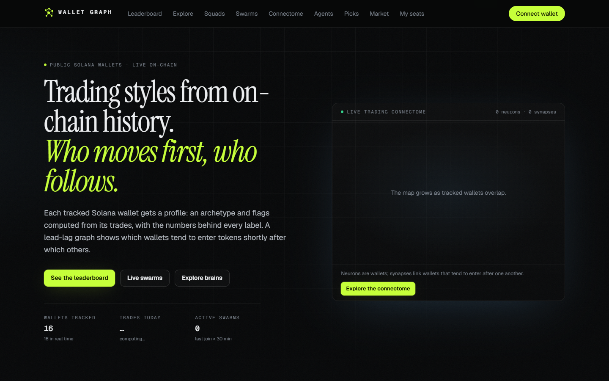

# Wallet Behavior Graph

Profiles Solana wallets from their on-chain trades and maps how they follow each other. Each tracked wallet (called a "brain" in the code) gets an archetype and flags from deterministic rules, with the numbers that triggered each label. A lead-lag graph (the "connectome") links wallets that repeatedly enter the same tokens shortly after one another. Claude, with OpenAI as a fallback, writes plain-language explanations on top of those numbers but never invents a label.



## What it does

**Ingestion** (`src/server/ingest`). Pulls wallet history from Helius or any RPC, normalizes each transaction from the wallet's own balance changes into buys and sells, enriches tokens with launch time, launchpad and market data (Jupiter, DexScreener), and prices SOL at the minute of the trade. Writes are deduplicated and retried on SQLite lock contention. A Helius webhook feeds live trades for the most active wallets; the rest are reconciled on a schedule.

**Profiles** (`src/server/profile`). `computeProfile` is a pure function from trades to a profile: realized PnL, ROI, win rate shrunk toward the population rate, hold-time buckets, entry market cap and delay, sizing, exits and the best trading window. Archetypes are checked in order (`deployer`, `bot_flipper`, `sniper`, `early_ape`, `momentum_chaser`, `intraday`, `swing`, `diamond_hands`), and wallets under 20 trades or 5 tokens stay `unrated`. Flags such as `disciplined`, `bag_holder`, `partial_tp`, `rug_exposed` and `hard_to_copy` sit on top. The `/methodology` page documents every rule.

**Connectome** (`src/server/connectome`). From each wallet's first buy per token over 30 days:

- A co-entry is wallet B buying within 60 minutes after wallet A. It counts `idf(token) * exp(-lag / 900 s)`, so widely held tokens and long lags count less.
- Entries 2 slots apart or closer are treated as bundled, not as one wallet leading another.
- Each pair is tested against 100 within-token permutations. A synapse is kept at z >= 3 with at least 3 shared tokens.
- Weighted PageRank for influence, Louvain communities (graphology) for regions, cascade and strongest-path tracing, and sell-then-buy capital rotations.
- Rendered with sigma.js and ForceAtlas2, and streamed live over SSE.

**Swarms** (`src/server/signals/swarms.ts`). Flags tokens where several tracked wallets made their first buy within a short window. The same pure function runs on live trades and on backfilled history, so both produce the same result.

**AI** (`src/server/ai`). Trade explanations, style playbooks and chat about a wallet, built from the computed facts only. Anthropic is tried first and the process switches to OpenAI on billing, auth or outage errors. Hourly call caps are configurable.

**Agents and picks** (`src/server/agents`, `src/server/picks`). `deriveStrategy` turns a profile into trading rules, and every rule records which statistic it came from. Agents trade in a wallet's style, never copying its trades. They start on paper with 5 simulated SOL, filled at real Jupiter quotes minus latency, fees and rent. Live mode is off unless `AGENTS_LIVE_ENABLED=true` and the owner acknowledges the custodial risk. The picks engine runs the same rules plus a council (swarms, tracked-wallet flow, graph leaders) and only tracks results on paper. It never places orders.

**Access passes** (`src/server/solana`). Access to live alerts, picks and agents is gated by Metaplex Core assets with a resale market, minted by a server authority on the configured cluster (devnet by default). Sign-in is Sign-In With Solana.

## Getting started

Requirements: Node 24 and pnpm 10.

```bash
pnpm install
pnpm db:migrate     # creates data/wbg.db
pnpm seed           # loads the 16 synthetic wallets in data/directory/
pnpm dev            # http://localhost:3000
```

This runs with no keys. Pages render with the sample wallets, which have no on-chain history, so trade-based views are empty. To track real wallets:

1. Copy `.env.example` to `.env.local` and run `pnpm keygen`. It writes the server keypairs and secrets (session secret, agent master key) into `.env.local`.
2. Put your own wallet list in `data/directory/sample-directory.json`, using the shape described in `data/directory/README.md`, then run `pnpm import:directory`.
3. Set `HELIUS_API_KEY` (recommended) or `DATA_RPC_URL`, then run `pnpm worker` in a second terminal. It handles backfill, live polling, profile recompute, graph and swarm snapshots, and AI explanations.
4. For AI text set `ANTHROPIC_API_KEY` and/or `OPENAI_API_KEY`.
5. `pnpm agents` runs paper agents and the picks engine.

## Configuration

Every variable is listed in `.env.example` and validated with zod in `src/lib/env.ts`. A feature whose key is missing fails with a `Missing configuration: ...` error instead of quietly doing less.

| Feature | Needs |
|---|---|
| Wallet history | `HELIUS_API_KEY` or `DATA_RPC_URL` |
| Live trades by webhook | `HELIUS_API_KEY`, `HELIUS_WEBHOOK_AUTH`, a public https `PUBLIC_URL` |
| Sign-in | `SESSION_SECRET` (from `pnpm keygen`) |
| Access passes and market | keygen output, and a funded mint authority on `SOLANA_CLUSTER` |
| AI explanations and chat | `ANTHROPIC_API_KEY` and/or `OPENAI_API_KEY` |
| Agents | `AGENT_MASTER_KEY` (keygen), plus `HELIUS_API_KEY` or `AGENT_RPC_URL` |
| Admin pages | `ADMIN_WALLETS` |

## Commands

| Command | What it does |
|---|---|
| `pnpm worker` | Long-running jobs: backfill, live polling, reconciles, profiles, graph and swarm snapshots, AI text |
| `pnpm agents [-- --picks-only]` | Agent runner and picks engine |
| `pnpm agents:admin <cmd>` | Derive and inspect strategies, create paper agents, simulate a live swap without sending it |
| `pnpm import:directory` | Load `data/directory/` into the database |
| `pnpm profiles:recompute` | Recompute stored profiles after a methodology change |
| `pnpm webhook:sync` | Create or update the Helius webhook for live-tier wallets |
| `pnpm smoke:chain` | End-to-end pass flow (mint, renew, list, buy, delist) against `SOLANA_RPC_URL` |
| `pnpm test` | vitest: profile computation and scoring, graph metrics, swarms, transaction normalization, strategy derivation, tx guards and more |

The production `Dockerfile` builds the web app. Run `pnpm worker` and `pnpm agents` as separate processes from the same image.

## Checks

```bash
pnpm exec next typegen   # route types, needed once before typecheck on a fresh clone
pnpm typecheck
pnpm lint
pnpm test
pnpm build
```

CI runs all of these on every push.

## License

MIT
